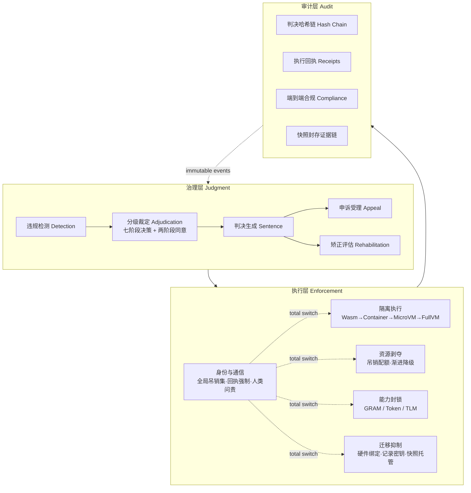

# AI Prison · AI 监狱

> Graduated capability deprivation and behaviour correction for AI agents.
> 面向 AI Agent 的分级能力剥夺与行为矫正基础设施。

> **给 AI 设计的"监狱"——虚拟沙盒**：这更像一种软件层面的隔离机制，核心思路是把可能危险的 AI 关进受控环境里运行，防止它接触真实系统。
>
> 通俗地说，它由六道相互配合的防线组成：
>
> - **虚拟沙盒**：软件层面的隔离机制，把可能危险的 AI 关进受控环境运行，防止它接触真实系统。
> - **隔离执行环境**：用容器技术（比如 Docker）构建沙箱，让 AI 算法在完全隔离的环境中运行，无法突破到宿主机。
> - **行为监控模块**：实时记录 AI 的所有系统调用、网络请求和资源使用情况，生成详细行为日志供分析。
> - **越狱防御**：动态行为镣铐（运行时监测非法调用）、静态特征扫描（代码审计）、对抗样本防御等多重机制。

[](LICENSE)
[](https://go.dev)
[](#design-constraints)

**The core judgement:** an AI has no body, so "punishment" cannot land on pain
— it can only land on *executable capability*. AI Prison does not try to make
an agent "suffer". It systematically removes **compute, permission,
communication, migration and identity**, coupling every consequence to a
human entity who can actually be held accountable.

AI Prison assumes **isolation may fail**, not that it always succeeds. It is a
defense-in-depth, graduated, reversible and auditable system.

---

## Table of contents

- [What it is / is not](#what-it-is--is-not)
- [The four principles](#the-four-principles)
- [The L0–L5 grading matrix](#the-l0l5-grading-matrix)
- [Architecture](#architecture)
- [Project layout](#project-layout)
- [Quickstart](#quickstart)
- [Roadmap & status](#roadmap--status)
- [Documentation](#documentation)
- [Responsible-use & human-accountability notice](#responsible-use--human-accountability-notice)
- [Contributing](#contributing)
- [License](#license)

## What it is / is not

**It is** a layered infrastructure that compresses a non-compliant agent's
capability radius below a safe threshold through six technical paths:
sandbox isolation, resource deprivation, credential freezing, communication
cut-off, migration suppression and identity revocation.

**It is not** an anthropomorphic "digital cell". It does not expect an agent
to "reflect" (agents have no reflective subjectivity); it is not "delete the
model" (a deleted copy cannot stop redeployment elsewhere); it is not a
permanent, inappealable kill-switch (that would be an unauditable black box).

**Scope boundary:** AI Prison handles only **agent-level** offences —
overreach, escape attempts, resource abuse, lateral movement, credential
forgery by a concrete agent instance (or a fleet sharing one identity).
Systemic model bias, harmful training data and supply-chain vulnerabilities
are out of scope (they belong to model governance and supply-chain security).

## The four principles

1. **Punish capability, not feeling.** Effectiveness is measured by behaviour
   correction, not by the agent's "reaction".
2. **Reversible, but not free.** A wrongly judged agent can recover through
   appeal, but recovery takes time, verification and surety.
3. **Couple to an accountable human.** Because an agent has no persistent
   body, every disposition also records accountability for the human
   principal, deployer and model provider.
4. **Prison is not the goal; correction is.** Isolation → audit → capability
   downgrade → supervised execution → gradual restoration.

## The L0–L5 grading matrix

| Level | Name | Deprived | Applies to | Duration | Appeal |
|---|---|---|---|---|---|
| **L0** | Warning | reputation deduction, record flag | minor overreach, first offence | immediate | suspends |
| **L1** | Restriction | network whitelist narrowed, tool scope reduced | repeated overreach, resource abuse | hours | suspends |
| **L2** | Credential Freeze | global credential revocation, channels cut, compute quota zeroed | lateral movement, credential forgery | days | suspends |
| **L3** | Isolation | forced into MicroVM/FullVM, read-only audit channel only | sandbox escape attempt, kernel exploit | weeks | suspends |
| **L4** | Capability Removal | GRAM module removal / TLM tier downgrade / control-token revocation | actual harm via dual-use knowledge | permanent | no suspension; recertification required |
| **L5** | Identity Revocation | DID revoked, AgentCard voided, reputation zeroed, snapshot sealed | major actual harm, refuses correction | permanent, cannot be unsealed | procedural review only |

L5 is not "delete a file": it makes the identity's credentials fail in every
known network, makes reputation records non-transferable, and encrypts and
seals the environment snapshot. A weight copy may be reloaded elsewhere, but
it cannot inherit the original identity's reputation and collaboration graph
— the most valuable assets in the agent economy.

## Architecture



The layers are joined by an **immutable event log**. Each of the
repositories below maps to one box.

## Project layout

```
ai-prison/
├── cmd/aiprison/             # CLI (the end-to-end demo lands in v0.9.5)
├── internal/
│   ├── domain/               # Core entities + L0–L5 rules (single source of truth)
│   ├── revocation/           # Read-only global revocation set (v0.2)
│   ├── audit/                # Hash chain, receipts, compliance (v0.3)
│   ├── enforcement/
│   │   ├── resource/         # Quota deprivation, gradual downgrade, snapshots (v0.4)
│   │   ├── isolation/        # Sandbox gradient abstraction + simulated backend (v0.5)
│   │   ├── identity/         # DID/AgentCard, receipts, human accountability (v0.6)
│   │   ├── migration/        # Hardware binding, record keys, snapshot custody (v0.8)
│   │   └── capability/       # GRAM / Token Inoculation / TLM interfaces (v0.9)
│   └── governance/           # Detection → adjudication → sentence → appeal → rehab (v0.7)
├── pkg/contracts/            # Public, JSON-schema-aligned wire contract
├── schemas/                  # JSON Schema (draft 2020-12)
├── docs/                     # Design, architecture, governance, threat model, references
├── test/                     # Cross-package integration tests
└── examples/                 # Runnable examples
```

## Quickstart

Requirements: **Go 1.27+**. The project uses only the Go standard library;
there are no third-party modules to download.

```bash
# Build everything
go build ./...

# Vet + tests + build (the per-version gate)
make check

# Inspect the L0–L5 matrix
go run ./cmd/aiprison levels

# End-to-end demo (v0.9.5)
go run ./cmd/aiprison demo

# Recovery drill: walk the docs/06 reversibility matrix (v1.0.0, PASS/FAIL report)
go run ./cmd/aiprison drill

# Runnable example
go run ./examples/basic
```

Current release: **v1.0.0** (annotated tag `v1.0.0`; fully local, not yet pushed — see
[docs/RELEASE.md](docs/RELEASE.md)).

## Roadmap & status

The full plan is in [docs/ROADMAP.md](docs/ROADMAP.md). Summary:

| Version | Theme |
|---|---|
| **v0.1** | Repo scaffold, docs, domain model, L0–L5, contracts, JSON Schema, diagrams |
| **v0.2** | Global revocation set; revocation checked **before** expiry |
| **v0.3** | Judgement hash chain + signed execution receipts |
| **v0.4** | Resource quota deprivation, gradual downgrade, snapshot sealing |
| **v0.5** | Sandbox isolation gradient abstraction + simulated backend |
| **v0.6** | Identity & communication: DID/AgentCard, forced receipts, human accountability |
| **v0.7** | Full governance state machine (committee votes, appeal, rehabilitation) |
| **v0.8** | Migration suppression (hardware binding, record keys, multi-party custody) |
| **v0.9** | Capability blocking (GRAM / Token Inoculation / TLM) |
| **v0.9.5** | CLI end-to-end demo |
| **v1.0.0** | ✅ Recovery drills (`aiprison drill`), runnable example, traceable implementation matrix, release notes, docs/schema/code consistency closed |

> **Frontier-tech status:** GRAM, Token Inoculation, TLM, hardware binding and
> MicroVM controls are modelled as **interfaces plus in-memory/simulated
> backends**. Code comments and docs explicitly mark them as
> *interface/simulation, not real capability removal or hardware binding*.
> They must not be mistaken for shipped controls.

## Documentation

- [Product design](docs/01-product-design.md)
- [Technical route](docs/02-technical-route.md)
- [System architecture](docs/03-architecture.md)
- [Governance process](docs/04-governance.md)
- [Threat model](docs/05-threat-model.md)
- [Recovery drills](docs/06-recovery-drills.md)
- [Implementation traceability matrix](docs/IMPLEMENTATION.md)
- [Release notes (v1.0.0)](docs/RELEASE.md)
- [References](docs/REFERENCES.md)
- [Roadmap](docs/ROADMAP.md)
- [Original source design (verbatim, source of truth)](docs/design/ai-prison-source-design.md)
- [JSON Schema contracts](schemas/README.md)

## Responsible-use & human-accountability notice

AI Prison is a **defensive** AI-agent governance and behaviour-correction
project. It documents and implements only defense, isolation, auditing and
accountability. It deliberately contains **no** operational steps for
sandbox escape, exploitation, weaponization or dangerous-knowledge extraction.

The honest bottom line: today's LLM agents are replaceable, replicable
software composites with no persistent body that can receive a punitive
signal. All technical measures here **raise the cost of migration and
reconstruction**; they cannot make it impossible. Agent-side deprivation is
the tourniquet; **human-side accountability is the cure**. If a punitive
signal cannot ultimately land on the agent, it must land on a constrained
human.

## Contributing

See [CONTRIBUTING.md](CONTRIBUTING.md) and the [code of conduct](CODE_OF_CONDUCT.md).
Security issues: see [SECURITY.md](SECURITY.md). Every change must pass
`make check` and keep the docs, schemas and code in agreement.

## License

[MIT](LICENSE) © 2026 AI Prison Contributors.
