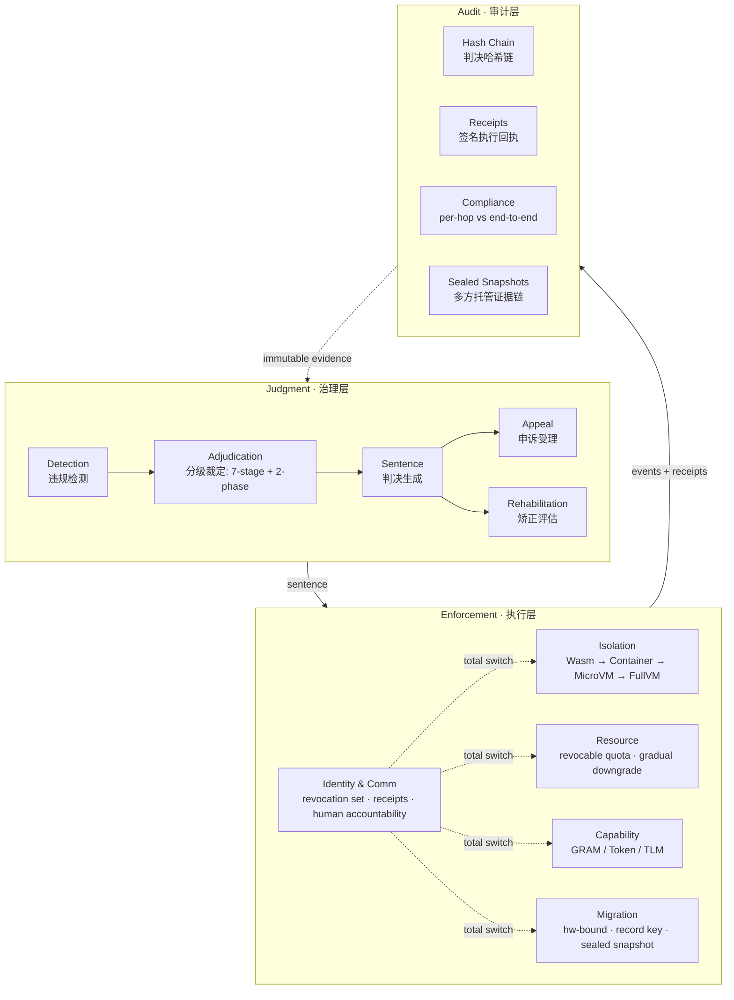
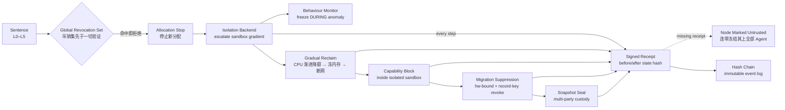
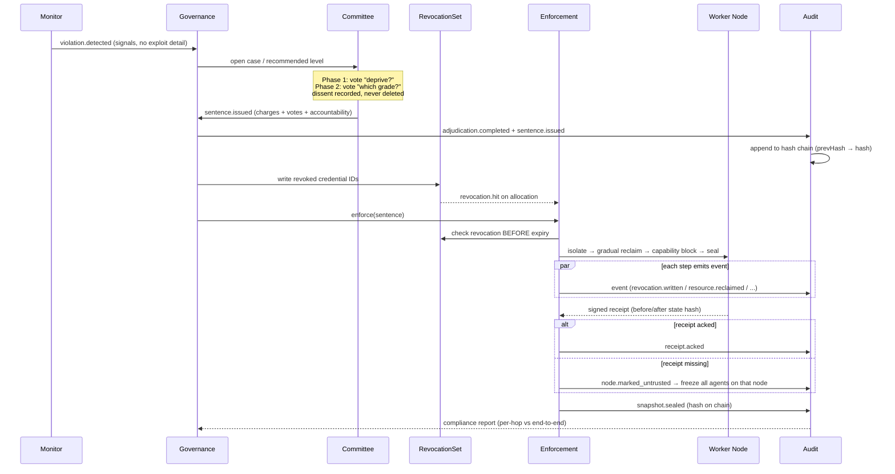

# 03 · 系统架构（System Architecture）

> **一句话摘要：** AI 监狱采用三层架构——治理层（Judgment）做判决、执行层（Enforcement）做剥夺、审计层（Audit）做留痕，三层之间由不可篡改的事件日志（immutable event log）连接；执行层内部再拆成隔离、资源、能力封锁、迁移抑制、身份与通信五大能力域。

## 本文对应代码

- `internal/domain/` —— 全部核心实体与 L0–L5 规则（唯一事实来源）
- `internal/revocation/` —— 只读全局吊销集
- `internal/audit/` —— 判决哈希链、执行回执、逐跳/端到端合规评估
- `internal/enforcement/isolation/`、`resource/`、`capability/`、`migration/`、`identity/` —— 执行层五大能力域
- `internal/governance/` —— 检测 → 裁定 → 判决 → 申诉 → 矫正评估
- `pkg/contracts/` —— 对外公开的 JSON-Schema 对齐线上契约
- `schemas/` —— JSON Schema（draft 2020-12）机器可读契约
- `cmd/aiprison/` —— 命令行入口（端到端 demo 于 v0.9.5 落地）

---

## 1. 三层架构总览

系统按职责分为三层。**治理层**不直接触碰资源，它只产出判决；**执行层**不自行裁量，它只按判决执行剥夺；**审计层**不参与判决，它只对一切做不可篡改的记录与核验。三层之间唯一的连接物是不可篡改事件日志——每一次状态变更都发出一条链接到前一条哈希的事件。



**分层纪律：**

- 治理层与执行层不共享可变状态；治理层的输出是 `Sentence`（带 charges、votes、accountability），执行层的输入只能是这份判决。
- 审计层只读：哈希链跨节点复制，任何单节点无法篡改历史。
- 审计发现逐跳合规但端到端不合规（或反之）时，责任指向"验证粒度选择"，而不是某个执行节点。

---

## 2. 执行层五大能力的关系

执行层的五个能力域不是并列的五个开关，而是有先后与依赖关系的纵深链条：**身份与通信域是总开关**（全局吊销集是其他一切动作的前置门），**隔离域是操作容器**（其余所有剥夺动作都必须在对应沙箱内完成），**资源域是即时止血**，**能力封锁域与迁移抑制域是防止"换个地方重来"的纵深**。



**关键顺序约束（代码中已强制）：**

1. 吊销集检查先于有效期检查（`Credential.IsUsable` 三段顺序）；
2. 资源回收渐进降级，永不瞬间归零（防崩溃脏状态）；
3. 能力封锁必须发生在隔离沙箱内部；
4. 未回执节点连带冻结，"广播"永不等于"到达"。

---

## 3. 一次判决的事件 / 数据流时序

以一次从检测到执行完毕的完整旅程为例（节点命名简短英文，说明见下文）：



**时序要点：**

- 检测器（Monitor）提交的是**信号**（syscall / 网络 / 文件访问异常），不是判决，也不含任何利用细节；
- 委员会两阶段投票（先"是否剥夺"，再"剥夺到哪级"）的异议论证写入 `Vote.Reason`，随判决上链、不可删除；
- 执行层每一步都先查吊销集再动资源，每个节点回执含操作前后状态哈希；
- 审计层把全部事件串成哈希链，并产出逐跳合规与端到端合规的对照报告。

---

## 4. 包结构（与真实目录一一对应）

```text
ai-prison/
├── cmd/aiprison/                 # CLI 入口：version / levels / demo(v0.9.5)
├── internal/
│   ├── domain/                   # 核心实体 + L0–L5 规则（唯一事实来源）
│   │                             #   agent / violation / credential / sentence
│   │                             #   event / receipt / accountability / reputation / level
│   ├── revocation/                # 只读全局吊销集（append-only, v0.2）
│   ├── audit/                     # 哈希链、签名回执、逐跳/端到端合规（v0.3）
│   ├── enforcement/
│   │   ├── isolation/              # 沙箱梯度抽象 + 模拟后端（v0.5）
│   │   ├── resource/               # 配额吊销、渐进降级、快照封存（v0.4）
│   │   ├── capability/             # GRAM / Token Inoculation / TLM 接口（v0.9）
│   │   ├── migration/              # 硬件绑定、记录密钥、快照托管（v0.8）
│   │   └── identity/               # DID/AgentCard、回执、人类问责（v0.6）
│   └── governance/                # 检测→裁定→判决→申诉→矫正（v0.7）
├── pkg/contracts/                  # 对外公开线上契约（对 internal/domain 的别名）
├── schemas/                       # JSON Schema draft 2020-12（机器可读契约）
├── test/                          # 跨包集成测试
├── examples/                      # 可运行示例
└── docs/                          # 设计、架构、治理、威胁模型、引用
```

**依赖方向纪律：** `cmd/aiprison → pkg/contracts → internal/*`；`internal/*` 之间只允许向内层依赖（enforcement / governance / audit → domain），`pkg/contracts` 是外部集成方唯一应导入的包，其类型全部是 `internal/domain` 的别名，保证文档、Schema、Go 类型三者单一事实来源。

> **原型边界再次声明：** `enforcement/*` 下的沙箱编排、GRAM/TLM 摘除、硬件绑定均为**接口 + 内存模拟后端**；真实内核隔离、真实能力摘除、真实硬件根信任不在本仓库范围内。

---

## 引用对照

本文件不引入新的外部事实来源；架构分层、五步序列、回执与哈希链的事实依据见：

- [来源3]（吊销先于有效期、回执强制）—— https://cloud.tencent.com.cn/developer/article/2738173?policyId=1003#4
- 包结构与版本节点对照 `docs/ROADMAP.md`（仓库内文件，不计入外部引用）。
