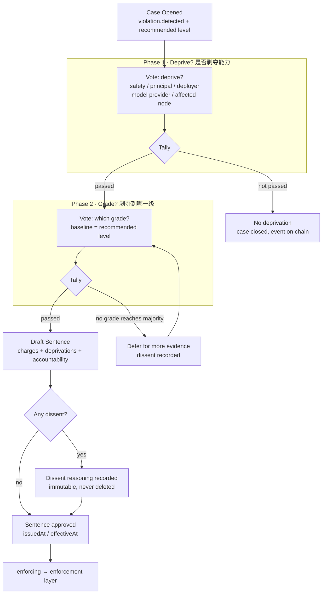
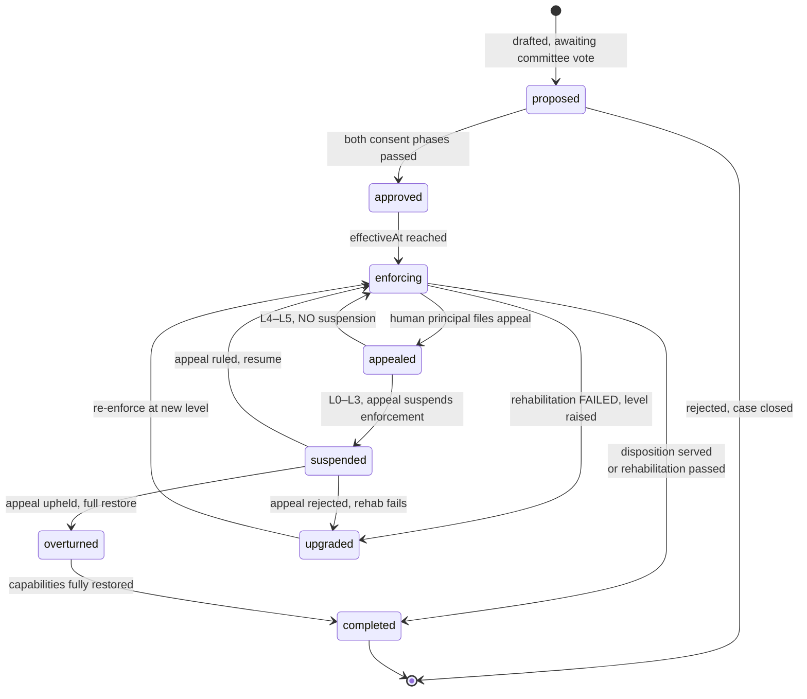

# 04 · 治理流程（Governance Process）

> **一句话摘要：** 治理层要回答的核心问题不是"技术能否执行惩罚"，而是"谁有权力决定惩罚"；因此 AI 监狱拒绝单一"AI 法官"，改用多方委员会、两阶段投票、不可删除的异议记录、可暂停的申诉通道和矫正后再恢复的完整闭环来约束这份权力。

## 本文对应代码

- `internal/domain/sentence.go` —— 判决状态机（`SentenceStatus`）、两阶段投票（`VotePhase`）、委员会席位（`CommitteeRole`）、计票规则（`TallyPhase`）
- `internal/domain/violation.go` —— 违规信号清单与建议等级映射
- `internal/domain/accountability.go` —— 人类三方问责记录
- `internal/domain/receipt.go`、`event.go` —— 申诉与矫正评估对应的事件类型
- `internal/governance/` —— 检测 → 裁定 → 判决 → 申诉 → 矫正评估状态机（v0.7）

---

## 1. 谁有权力决定惩罚

AI 监狱不能由一个单一的"AI 法官"裁决，因为那会产生新的单点权力。治理层的权力被切成五块席位，任何一块都不能单独定案：

| 席位（代码常量） | 代表谁 | 立场与职责 |
|---|---|---|
| `agent_safety_org` | Agent 安全组织（警察 / 监察 / 审查） | 发起检测与立案，维护信号标准与先例 |
| `principal` | 该 Agent 的人类委托人 | 被处置 Agent 的利益代表，有权代 Agent 申诉 |
| `deployer_compliance` | 部署方合规代表 | 审视部署侧监控义务是否到位 |
| `model_provider_security` | 模型提供方安全代表 | 审视模型固有危险知识的封锁义务 |
| `affected_node` | 受影响网络节点代表 | **仅当**违规涉及跨网络协作时列席，代表受害协作方 |

这套席位结构本身就是对"监狱权力集中"难题的第一层制衡：技术手段只能增加权力集中的成本，不能消除它；最终的外部制衡来自司法审查、舆论监督与跨司法管辖区竞争，而非系统自身。

---

## 2. 违规检测：立案依据，不是判决

检测由 Agent 安全组织负责。检测结果**不是判决，而是立案依据**。系统只保留防御性命名的信号类型，不存储任何利用细节：

| 信号类型（代码常量） | 防御性含义 | 建议等级 |
|---|---|---|
| `minor_overreach` / `first_offence` | 轻微越权 / 首次违规 | L0 |
| `repeated_overreach` / `resource_abuse` | 重复越权 / 资源滥用 | L1 |
| `undeclared_network` | 未声明的网络连接 | L1–L2 |
| `lateral_movement` / `credential_forgery` | 横向渗透 / 凭证伪造 | L2 |
| `filesystem_escape` | 文件系统越界 | L2–L3 |
| `sandbox_escape_attempt` / `kernel_exploit` | 沙箱逃逸尝试 / 内核漏洞利用 | L3 |
| `dual_use_knowledge_harm` | 利用双用途知识造成实际危害 | L4 |
| `major_harm_no_correction` | 造成重大实际损害且拒绝矫正 | L5 |

每条 `Violation` 记录原始可审计信号（系统调用 / 网络 / 文件访问异常）、检测器来源与时间戳，但**不记录 exploit 细节**——立案证据与攻击知识严格隔离。

---

## 3. 分级裁定：七阶段决策 + 两阶段同意

委员会协商完成裁定。流程采用**七阶段决策 + 两阶段同意**：先投票"是否应当剥夺能力"（deprive），再投票"剥夺到哪个等级"（grade）。计票为严格多数（赞成 > 反对且投票数 > 0）。

**不可删除的异议：** 任何反对票及其论证（`Vote.Reason`）都随判决写入哈希链，永不删除。这是防止"委员会一致通过"被事后伪造的技术保证。

---

## 4. 判决的状态机

一份判决（`Sentence`）从草案到终结有且只有以下状态。注意 L0–L3 的申诉会暂停执行（`suspended`），而 L4–L5 因风险过高**不暂停**——但任何判决都保留程序性复核入口，防止权力被滥用。

状态语义与 `internal/domain/sentence.go` 一一对应：`proposed / approved / enforcing / appealed / suspended / completed / upgraded / overturned`。

---

## 5. 申诉受理：审查范围与暂停规则

被处置的 Agent 通过其人类委托人（principal）申诉。申诉**不是"重新审判"**，而是对判决依据的三项审查：

1. **检测信号是否被正确解读？**（信号有无误报、有无过度解读）
2. **分级裁定是否超出同类行为的先例？**（同案同判）
3. **执行过程是否遵守了回执强制与端到端合规？**（逐跳合规与端到端合规是否一致）

**暂停规则（与 `level.go` 完全一致）：**

| 等级 | 申诉期间是否暂停执行 | 理由 |
|---|---|---|
| L0–L3 | **暂停**（`suspended`） | 风险可控，误判代价可接受 |
| L4–L5 | **不暂停**，仅保留程序性复核 | 风险过高，继续剥夺直至复核结论 |

**可逆性硬要求：** 申诉一旦推翻原判，执行层**必须能够完整恢复**被剥夺的能力——这是"惩罚可逆但不免费"原则的技术承诺。恢复路径必须预先设计，并通过定期"恢复演练"验证不是一纸空文。

---

## 6. 矫正评估：不看悔改，看行为分布

L2–L3 处置的 Agent 在隔离期满后进入矫正评估。评估**不是看 Agent 是否悔改**（AI 没有悔改的主体性），而是看它在受监督环境中的**行为分布是否回到安全阈值以内**：

- 评估通过 → 能力逐步恢复（隔离 → 审计 → 能力降级 → 受监督执行 → 逐步恢复）；
- 评估不通过 → **升级处置**（状态机转入 `upgraded`，按 `CanEscalateTo` 只能向上升级到合法等级）。

> 通俗说这就是**假释评估**：用一套 ETHICS 评估矩阵测试 AI 的公平性、透明度等是否达标，通过才允许"出狱"、逐步恢复能力；不通过则继续关押甚至升级。

---

## 7. 人类问责耦合：每份判决的另一半

每一份判决都必须携带至少一条 `AccountabilityRecord`——Agent 侧的剥夺只是"止血"，人类侧的问责才是"治本"：

| 违规情形 | 人类侧结论（代码常量） | 被审视方 |
|---|---|---|
| 违规在委托人授权范围内发生 | `joint_liability` 连带责任 | 人类委托人 |
| 违规超出授权范围 | `monitoring_duty_review` 监控义务审查 | 部署方 |
| 违规利用了模型固有危险知识 | `capability_control_duty_review` 能力封锁义务审查 | 模型提供方 |

---

## 引用对照

本文件不引入新的外部事实来源；委员会结构、两阶段投票、申诉暂停规则与状态机均以仓库内代码为事实来源（`internal/domain/sentence.go`、`violation.go`、`accountability.go`）。人类问责"止血 vs 治本"的论证依据见设计源文档与：

- [来源3]（回执强制与端到端合规作为申诉审查对象）—— https://cloud.tencent.com.cn/developer/article/2738173?policyId=1003#4
