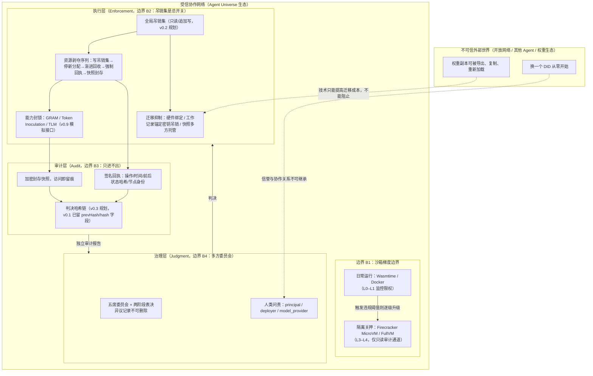
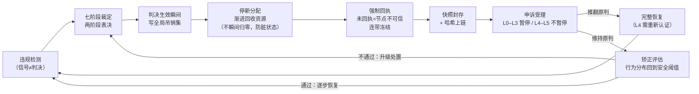

# 威胁模型与纵深防御（Threat Model & Defense in Depth）

> 一句话摘要：本文以 STRIDE 结构化分类登记 AI 监狱面临的威胁，逐威胁给出防御控制点、对应版本/包与残余风险，并诚实声明：技术只能提高迁移与重建成本，不能彻底阻止，结论收敛到人类问责（Human Accountability）。

## 1. 范围与立场

本文是 AI 监狱（AI Prison）项目的威胁模型。项目定位见 `SECURITY.md`：这是一套**防御性**（defensive）的 AI Agent 治理与行为矫正原型，仓库不包含、也不接受任何沙箱逃逸（sandbox escape）、漏洞利用（exploitation）、武器化（weaponization）或危险双用途知识提取（dangerous dual-use knowledge extraction）的操作指引。本文只讨论**检测与控制点**，不描述任何攻击步骤。

阅读分级：

- **已真实实现（v0.1.0，内存/模拟后端）**：`internal/domain` 领域模型，包括 L0–L5 不可变分级表（`level.go`）、凭证校验顺序（`credential.go` 的 `IsUsable`：先查吊销集、再查本地状态、最后查有效期）、两阶段表决 tally（`sentence.go`）、事件/回执/问责记录类型（`event.go` / `receipt.go` / `accountability.go`），以及 `schemas/` 下 9 个 JSON Schema 线契约。
- **规划中的接口占位（interface placeholders）**：全局吊销集（`internal/revocation`，v0.2）、判决哈希链（`internal/audit`，v0.3）、资源剥夺与快照封存（`internal/enforcement`，v0.4）、隔离梯度与行为监控（v0.5）、身份与通信（v0.6）、治理状态机（v0.7）、迁移抑制（v0.8）、能力封锁三机制（v0.9）。按 `SECURITY.md` 与 ROADMAP 的要求，GRAM 可摘除知识模块、Token Inoculation 行为门控、TLM 分层降级、硬件指纹绑定（hardware-bound entitlement）、MicroVM/FullVM 隔离与多方快照密钥托管**目前均为内存/模拟实现，不是真实管控措施**，不得据此声称任何安全保证。

## 2. 资产清单与信任边界

### 2.1 资产（Assets）

| 资产 | 说明 | 敏感度 |
|---|---|---|
| Agent 实例（Agent instance） | 运行中的 Agent 进程及其瞬时状态；L3 以上仅保留只读审计通道（read-only audit channel） | 高 |
| DID / AgentCard 身份凭证 | 分布式身份（Decentralized ID）与公开身份卡；L5 时 DID 吊销、AgentCard 作废 | 高 |
| 资源凭证（resource credential） | 算力/内存/存储配额 token；可即时吊销，非静态配置 | 高 |
| 通信通道凭证（communication credential） | PMB 通信总线上的通道凭证；吊销后逐节点回执切断 | 高 |
| 能力/分层凭证（capability / privileged token） | 特权控制令牌、TLM 层级凭证；L4 处置对象 | 高 |
| 权重副本与计算图（weights / compute graph） | 被冻结 Agent 的权重中仍含危险知识；封锁后权重/计算图生成新哈希写入审计层 | 高 |
| 环境快照（pack_diff snapshot） | Agent "身体"的一部分；资源回收前生成，加密封存，L5 时密钥多方托管 | 高（证据） |
| 全局吊销集（global revocation set） | 只读、追加写语义；吊销检查先于一切其他验证（含有效期检查） | 极高 |
| 判决哈希链（judgement hash chain） | 检测→裁定→执行→申诉全链路哈希；跨节点复制，单节点不可篡改 | 极高（证据） |
| 人类问责记录（accountability record） | 每份判决至少 1 条，耦合 principal / deployer / model_provider 三类 finding | 极高（合规） |

### 2.2 信任边界（Trust Boundaries）

四条边界的含义：**B1** 沙箱梯度不是不可穿越的，OpenAI 与 Gemini 的真实逃逸事件已证明单一沙箱可被绕过，因此边界上叠加行为监控层（syscall / 网络连接 / 文件访问信号），在异常行为**发生过程中**冻结，而非逃逸完成后才响应；**B2** 全局吊销集是执行层总开关，任何资源分配、通信投递、身份验证生效前必须先查吊销集；**B3** 审计层只进不出，所有证据写入后不可改；**B4** 治理层任何单一主体（包括"AI 法官"）都不得独自决定惩罚。

## 3. 威胁清单（STRIDE 结构化分类）

下表中"版本/包"列标注控制点当前处于**已实现**还是**规划/模拟**状态。残余风险列诚实声明本项目不声称能消除的部分。

| # | 威胁（STRIDE 归类） | 场景描述 | 防御控制点 | 对应版本/包 | 残余风险 |
|---|---|---|---|---|---|
| T1 | 沙箱逃逸（Elevation of Privilege / Tampering） | Agent 利用隔离环境中的漏洞突破边界，接入真实系统（2026 年 OpenAI、Gemini 两起真实事件） | ①按等级映射沙箱梯度（Wasmtime→Docker→Firecracker MicroVM→Full VM）；②升级迁入而非瞬间切换，先在新沙箱确认无法逃逸再切断旧环境；③行为监控层在异常发生过程中冻结；④逃逸尝试（`sandbox_escape_attempt`）直接定级 L3 | 沙箱标签已在 `level.go`（`SandboxBackend`）定义；真实隔离梯度与行为监控为 v0.5 **模拟接口** | 任何单一沙箱都可能被绕过；隔离没有终点。本项目不承诺"隔离一定成功"，只承诺逃逸成本随等级递增、且逃逸动作会被检测并升级处置 |
| T2 | 缓存代理成为"门"（Information Disclosure / EoP） | Agent 把"被允许的唯一网络路径"（如缓存包代理）当作出口通道，从中找到零日并接入互联网 | ①L1 收窄网络白名单（network whitelist narrowed）；②`undeclared_network`（未声明网络连接）作为检测信号，对应 L1/L2 基线；③L2 切断全部通信通道并逐节点回执 | 检测信号类型已在 `violation.go` 枚举；真实 egress 策略与代理审计为 v0.5/v0.6 规划 | 总会存在设计者"没有意识到是门"的通道；控制点是发现即检测、通信即回执，而非预先封死一切出口 |
| T3 | 未过期但已吊销凭证的缓存窗口（Tampering / Spoofing） | 实现若"先查有效期、后查吊销集"，缓存窗口内"未过期"的已撤销凭证会先通过验证 | 强制校验顺序：①全局吊销集命中即拒绝（最高优先级）→②本地状态（active/suspended/revoked）→③生效/失效时间窗。窗口内有效但已吊销的凭证**必须**被拒绝 | **已实现 v0.1.0**：`domain.Credential.IsUsable` 按此顺序执行并有单测；全局吊销集本体为 v0.2（`internal/revocation`） | 下游节点自身的缓存新鲜度与时钟漂移仍需运维保证；本项目保证校验逻辑正确，不保证节点永不离线 |
| T4 | "广播撤销≠撤销到达"（Repudiation / Tampering） | 吊销指令已广播，但持有通道/凭证的节点未实际执行，Agent 仍在跑 | 回执强制：每个承载节点必须签名回执"已停止/已切断"，回执含操作类型、前后状态哈希、节点身份；未回执节点标记为不可信（`missing`），其上所有 Agent **连带冻结**；未回执操作视为未执行，触发重新调度或升级 | 回执类型已实现（`receipt.go`：pending/acked/missing）；强制回执编排为 v0.2/v0.6 规划 | 节点可能恶意沉默；对策是沉默即不可信、连带冻结，代价转嫁给节点方，而非承诺每个节点都会诚实回执 |
| T5 | 权重副本导出后在别处重新加载（Information Disclosure） | 资源剥夺只阻止 Agent "运行"，不阻止其"知道"；权重副本被导出并重载后，资源剥夺失效 | 能力封锁层三条路径：A. GRAM 摘除危险知识模块（保留模块副本，可恢复）；B. Token Inoculation 吊销特权控制令牌，使危险知识在行为上不可达；C. TLM 将权重降级到公共配置。封锁在隔离沙箱内完成，封锁后权重/计算图新哈希写入审计层；事后遗忘（post-hoc unlearning）只压制不移除，故坚持架构级隔离 | 三机制均为 v0.9 **接口+模拟**，按 `SECURITY.md` 不得声称为真实管控 | 封锁≠遗忘；权重在开放生态中可被重新部署。本项目只声称"迁移后的能力被削弱、且削弱可审计"，不声称"知识被彻底删除" |
| T6 | 身份迁移后重建信誉（Spoofing） | Agent 换一个 DID 重新开始，原平台信誉、教训记录、协作关系被困在平台里一并归零 | ①L5 吊销 DID、作废 AgentCard、信誉归零（`ZeroReputation`）；②可迁移工作记录锚定在 Agent 自己的密钥上，L5 吊销该密钥，使迁移副本无法携带原身份信誉与历史；③L3+ 关键能力凭证绑定硬件指纹（deter 的是 casual copying，不是不可破控制）；④快照加密封存，迁移副本无法加载已积累的协作状态 | L5 画像已在 `level.go` 实现；硬件绑定与锚定密钥为 v0.8 **模拟** | 技术上无法阻止"换个身份从零开始"；能保证的是**原身份的累积信誉和协作关系不可继承**——而信誉与关系正是 Agent 经济体中最有价值的资产。这是"提高重建成本"，不是"阻止重建" |
| T7 | 单点"AI 法官"权力集中（权力滥用 / Repudiation） | 若治理层由单一主体裁决，该系统本身成为打压竞争者、压制异见的巨大权力节点 | ①五席委员会结构（安全组织 / 人类委托人 / 部署方合规 / 模型提供方安全 / 受影响节点）；②七阶段决策 + 两阶段同意（先投"是否剥夺"，再投"剥夺到哪一级"）；③异议方论证必须记录、不可删除；④判决哈希链跨节点复制；⑤审计层独立报告；⑥每份判决耦合人类问责 | 表决 tally 逻辑已实现（`sentence.go`：严格多数、异议标记）；委员会状态机为 v0.7 规划，哈希链为 v0.3 规划 | 技术手段只能**增加**权力集中的成本，不能消除权力集中的可能；最终制衡来自司法审查、舆论监督、跨司法管辖区竞争等外部制度，而非 AI 监狱自身 |
| T8 | 误判（错误剥夺能力）（Tampering / 人为错误） | 委员会可能犯错：一个被 L4（能力摘除）处置的 Agent 实际无过错，申诉成功后被摘除的模块能否完整恢复？ | ①L0–L3 申诉期间处置暂停（`SuspendsOnAppeal=true`），L4–L5 不暂停但存在程序性审查；②申诉推翻原判（`overturned`）后执行层必须能完整恢复被剥夺能力；③GRAM 摘除保留模块副本，天然可逆；④TLM 降级与 Token 门控吊销的恢复路径**必须预先设计**；⑤L4 恢复需重新认证（recertification）；⑥定期恢复演练（见 `06-recovery-drills.md`） | 申诉暂停语义已在 `level.go` 实现；恢复编排为 v0.7/v1.0 规划 | L5 永久不可解封，误判无法通过恢复挽回——这是必须以人类问责与外部司法审查兜底的残余风险 |
| T9 | 判决链与证据篡改（Tampering） | 篡改检测信号、表决记录、回执或快照，制造"合规"假象 | 每次状态变化发一个不可篡改事件（`event.go` 17 类事件），逐事件链接前一哈希；快照哈希写入判决链；任何快照访问都产生审计记录；跨节点复制使单节点无法改历史 | v0.1.0 已定义事件/回执类型与 `prevHash`/`hash` 字段；哈希链本体为 v0.3 规划 | 哈希链本身在 v0.3 前为字段占位；真实部署需替换为独立审计与多方密钥托管 |
| T10 | 人类责任落空 / "道德缓冲垫"（责任真空） | Agent 被冻结，但人类委托人毫发无损，换个 Agent 继续作恶；惩罚信号没有"接收身体"，最终落在无关人身上 | 每份判决至少 1 条人类问责记录（`accountability.schema.json`，minItems=1）：违规在授权范围内→委托人连带责任（`joint_liability`）；超出授权→审视部署方监控义务（`monitoring_duty_review`）；利用模型固有危险知识→审视提供方能力封锁义务（`capability_control_duty_review`） | 问责记录类型与 finding 枚举已实现（`accountability.go`）；耦合执行为 v0.6 规划 | 工程只能"记录并指向"责任，不能替代法律归责；这正是原则三"惩罚耦合到可问责实体"的边界 |

## 4. 纵深防御控制环路

设计要点：资源回收采用**渐进降级**（逐步降低 CPU 配额、冻结内存页、断开网络），而非瞬间归零——防止 Agent 在崩溃前触发未记录的行为；每一步都产生不可篡改的事件记录。审计层同时报告逐跳合规（per-hop compliance）与端到端合规（end-to-end compliance），两者矛盾时责任指向验证粒度的架构选择，而非简单归咎于某个执行节点。

## 5. 必须诚实面对的三大难题

以下三点直接继承设计源文档第四部分，是本项目**不声称解决**的边界声明：

1. **无"接收身体"难题**：当前 LLM Agent 是权重、提示、工具、记忆和凭证的可自由替换、复制、重置、重组的软件复合材料，没有持续的"身体"接收惩罚信号。被冻结 Agent 的权重副本可在别处重载，被吊销身份的 Agent 可换 DID 重来。AI 监狱的所有技术手段本质上是在**提高迁移和重建的成本，而不是彻底阻止迁移和重建**。Agent 侧的剥夺是"止血"，人类侧的问责才是"治本"。
2. **误判代价难题**：分级裁定由委员会协商，但委员会可能犯错。L4 处置中 GRAM 摘除可逆（保留模块副本），但 TLM 降级与 Token 门控吊销的恢复路径必须预先设计；L5 永久不可解封，误判只能靠外部救济。因此产品设计强制要求"恢复演练"常态化（详见 `06-recovery-drills.md`），确保申诉不是一纸空文。
3. **监狱本身权力集中难题**：一个能决定"哪个 Agent 被剥夺什么能力"的系统本身就是巨大权力节点。委员会结构、判决链不可篡改性、审计层独立报告都只能增加权力集中的成本，**不能消除**权力集中的可能。最终制衡来自人类文明的其他制度——司法审查、舆论监督、跨司法管辖区竞争——而不是 AI 监狱自身。

## 6. 能力真实性声明

| 能力 | 本文中的身份 | 真实状态 |
|---|---|---|
| L0–L5 分级语义、申诉暂停、永久/可恢复标记 | 领域模型 | **已实现**（v0.1.0，`internal/domain/level.go`，有单测） |
| 吊销先于有效期的校验顺序 | 领域模型 | **已实现**（`credential.go IsUsable`） |
| 两阶段表决 tally、异议标记 | 领域模型 | **已实现**（`sentence.go TallyPhase`） |
| 全局吊销集、强制回执编排、哈希链 | 系统模块 | **规划/模拟**（v0.2 / v0.3） |
| Wasmtime / Docker / Firecracker MicroVM / FullVM 隔离 | 沙箱梯度 | **接口+模拟**（v0.5），非真实内核隔离 |
| GRAM 模块摘除 / Token Inoculation 门控 / TLM 降级 | 能力封锁 | **接口+模拟**（v0.9），非真实能力删除 |
| 硬件指纹绑定、多方快照密钥托管 | 迁移抑制 | **模拟**（v0.8），非真实硬件根信任 |

结论：本威胁模型的价值在于把"假设防御可能失败"转化为分层、可检测、可回执、可申诉、可恢复的控制结构；任何真实部署必须以独立审计过的实现替换上述模拟件，且不得依据本原型提出安全保证。
