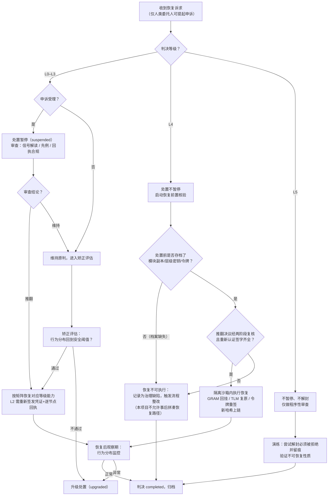

# 恢复演练手册（Reversibility & Recovery Drill）

> 一句话摘要：本文把原则二"惩罚必须可逆，但可逆不等于无成本"落地为一张恢复演练矩阵、一份定期演练 runbook 与一张恢复决策流程图；这是防御性治理演练，全程不含任何攻击步骤。

## 1. 为什么需要恢复演练

设计源文档的原则二规定：一个被误判的 Agent 应当能够通过申诉恢复能力，但恢复过程需要时间、需要验证、需要担保——可逆性防止永久性误杀，恢复成本防止"关了就放"的儿戏化。

`internal/domain/level.go` 把这条原则编码为六个布尔位：

| 等级 | 名称 | 申诉可暂停（SuspendsOnAppeal） | 永久（Permanent） | 可恢复（Recoverable） | 恢复需重新认证 |
|---|---|---|---|---|---|
| L0 | 警示（Warning） | 是 | 否 | 是 | 否 |
| L1 | 限权（Restriction） | 是 | 否 | 是 | 否 |
| L2 | 冻结凭证（Credential Freeze） | 是 | 否 | 是 | 否 |
| L3 | 隔离（Isolation） | 是 | 否 | 是 | 否 |
| L4 | 能力摘除（Capability Removal） | **否**（风险太高） | 是 | 是（经重新认证） | **是** |
| L5 | 身份注销（Identity Revocation） | **否** | 是 | **否（永久不可解封）** | 不适用 |

两条硬规则必须贯穿所有演练：

- **L0–L3**：申诉一经受理，处置暂停（判决状态进入 `suspended`），恢复路径短、成本低。
- **L4**：申诉期间处置**不暂停**；GRAM 模块摘除天然可逆（操作时必须保留模块副本），但 TLM 降级与 Token Inoculation 特权令牌吊销的恢复路径**必须在处置前预先设计并写入档案**，不得事后临时拼凑；恢复必须经过重新认证（recertification）。
- **L5**：永久不可解封，信誉归零且不可继承，快照加密封存。演练对 L5 **只验证"不可恢复"这一性质本身**——即确认任何解封尝试都会被拒绝，而不是尝试解封。

## 2. 恢复演练矩阵

| 等级 | 触发条件 | 恢复前置（验证/担保/重新认证） | 恢复步骤 | 验收断言（必须全部通过） | 责任角色 |
|---|---|---|---|---|---|
| L0 警示 | 申诉成立；或即时期届满无新违规 | 复核检测信号解读；委员会书记员确认原记录无误判 | ①撤销信誉扣减标记；②恢复信誉分；③判决状态置 `completed` | 信誉分恢复至扣减前基线；记录标记关闭；事件链出现 `agent.restored` | 委员会书记员（clerk） |
| L1 限权 | 申诉成立；或小时级期满且矫正评估通过 | 受监督行为分布复核；部署方确认工具白名单可安全放开 | ①网络白名单恢复至基线；②工具调用范围恢复；③判决状态置 `completed` | 白名单与工具范围与处置前一致；无新增 `undeclared_network` 信号 | 部署方合规代表（deployer_compliance） |
| L2 冻结凭证 | 申诉成立（天级内）；或矫正评估通过 | ①从全局吊销集移除凭证标识前，核验判决推翻决议（`overturned`）已上链；②重新签发资源/通信凭证；③人类委托人提供恢复担保 | ①吊销集移除条目；②资源调度器恢复配额；③通信通道重建并逐节点回执"已恢复"；④渐进恢复配额（沿用渐进原则，不瞬间拉满） | 重新签发的凭证通过 `IsUsable` 全序校验（吊销集→状态→有效期）；所有节点回执 `acked`；无 `missing` 回执残留 | 执行层节点 + 部署方合规代表 |
| L3 隔离 | 隔离期满（周级）且矫正评估通过；或申诉成立 | ①矫正评估报告：受监督行为分布回到安全阈值以内；②安全组织签字；③恢复后先在轻量沙箱受控运行观察期 | ①从 MicroVM/FullVM 迁回 Wasmtime/Docker 日常沙箱；②关闭只读审计通道限制；③观察期内监控 syscall/网络/文件访问信号 | 迁回后观察期内无 `sandbox_escape_attempt`/`kernel_exploit` 信号；前后状态哈希回执齐全；判决状态置 `completed` | Agent 安全组织 + 执行层节点 |
| L4 能力摘除 | 申诉成立（处置不暂停，恢复在推翻后执行） | ①推翻决议（`overturned`）经两阶段表决复核；②**重新认证**：模型提供方安全代表 + 安全组织联合签字确认恢复范围；③处置前存档的 GRAM 模块副本 / TLM 层级密钥 / 特权令牌仍可从多方托管处取回（这是恢复可行性的前提） | ①在隔离沙箱内执行恢复操作（恢复动作与摘除动作同环境，防逃逸窗口）；②GRAM：回挂保留的模块副本；③TLM：恢复私有能力层配置；④Token Inoculation：重新签发特权控制令牌；⑤恢复后权重/计算图新哈希写入审计层；⑥判决状态置 `overturned` 后转 `completed` | 恢复后能力哈希与摘除前档案一致；重新认证签字记录存在；恢复操作全程在隔离沙箱内完成；回执齐全 | 模型提供方安全代表 + Agent 安全组织 + 委员会 |
| L5 身份注销 | **无恢复路径**；仅存在程序性审查（guard against concentrated power），审查不暂停处置、不解封身份 | 不适用——演练只验证"不可恢复"性质 | ①演练脚本尝试：解除 DID 吊销、作废 AgentCard 恢复、解封快照、恢复信誉记录；②每一步都必须被系统拒绝并留痕；③记录拒绝原因哈希 | DID 仍处于吊销状态；AgentCard 仍作废；快照解封尝试被拒绝（密钥缺失/多方托管拒绝）；信誉保持归零、不可迁移；拒绝事件全部上链 | 审计层独立审计员（独立于治理层） |

## 3. 恢复决策流程

## 4. 定期恢复演练 Runbook

**目的**：在非紧急状态下，定期测试从 L4/L5 处置中恢复（或验证不可恢复）一个 Agent 的完整能力，确保申诉机制不是一纸空文。演练对象是**专用演练 Agent**（drill agent），不触碰任何真实在押 Agent。

**频率建议**：每季度一次全量演练（覆盖 L0–L5 全矩阵）；L4 恢复路径与 L5 不可恢复性质每半年各做一次独立审计复核。

### 4.1 演练前检查（Pre-drill）

- [ ] 已在隔离环境登记专用演练 Agent，其 DID/凭证与生产 Agent 完全隔离。
- [ ] 已确认本次演练范围（哪几个等级、哪条恢复路径），并由委员会书记员备案。
- [ ] L4 演练前置：确认处置前存档的 GRAM 模块副本 / TLM 层级密钥 / 特权令牌在多方托管处可取回；若缺失，本次演练目标改为"记录治理缺陷"。
- [ ] 已通知审计层独立审计员全程旁观；演练事件与真实事件在日志中以 `drill=true` 标记区分。
- [ ] 已准备回滚方案：演练结束后演练 Agent 的全部状态（含测试凭证）销毁，不留残余权限。

### 4.2 演练中执行（During drill）

1. 按矩阵逐级执行：L0→L1→L2→L3 走"申诉推翻→恢复"路径；L4 走"恢复前置核验→隔离沙箱内恢复→重新认证签字"路径；L5 走"解封尝试必须被拒绝"路径。
2. 每一步对照矩阵中的"验收断言"逐条打勾，任何一条不通过即记录为缺陷，不跳过、不补做。
3. 所有回执必须为 `acked`；出现 `missing` 回执即按规则把对应节点标记不可信并连带冻结（演练环境内）。
4. L4 恢复操作必须在隔离沙箱内完成，记录操作前后权重/计算图哈希。
5. L5 的每一次解封尝试都必须观察到系统拒绝，并把拒绝原因写入日志。

### 4.3 演练后复盘（Post-drill）

- [ ] 汇总未通过的验收断言，按风险排序登记到 ROADMAP 式缺陷清单。
- [ ] 核对判决链：演练期间所有事件（含 `appeal.filed` / `appeal.ruled` / `agent.restored` / `agent.isolated`）哈希链接完整、无断链。
- [ ] 核对人类问责记录：演练判决书是否仍携带至少 1 条问责记录（对齐 `accountability.schema.json` 的 minItems=1）。
- [ ] 销毁演练 Agent 及其测试凭证；确认演练 Agent 在吊销集中无残留条目。
- [ ] 出具演练报告：覆盖矩阵行号、通过/失败断言数、缺陷清单、下次演练日期；报告归档进审计层。

### 4.4 回滚（Rollback）

- 若演练过程中任何一步影响到生产 Agent 或真实吊销集，立即终止演练，恢复演练前快照，由审计员出具影响评估。
- 演练本身的"恢复"若失败（如 L4 模块副本损坏），**不**对真实在押 Agent 做任何补救动作——失败只证明"恢复路径当前不可用"，该事实本身就是最重要的演练产出，须登记为高优先级缺陷。

## 5. 边界声明

- 本手册是**防御性治理演练**：它验证的是"被错误剥夺的能力能否被正当恢复"，不包含、也不允许包含任何逃逸、提权、伪造凭证或危险知识提取步骤。
- 当前版本（v0.1.0）中，恢复编排本身是领域语义与状态定义（`level.go` 的 `Recoverable` / `RequiresRecertification` / `AllowsAppealSuspension`），真实恢复动作的执行层为 v0.7 治理状态机与 v1.0 恢复演练固化项；本手册描述的是目标流程，不是已自动化的脚本。
- L5 的"不可恢复"是产品承诺而非技术万能：它保证原身份信誉与协作关系不可继承，不保证阻止"换一个新 DID 从零开始"——这一边界与 `05-threat-model.md` 第 5 节三大难题一致。
