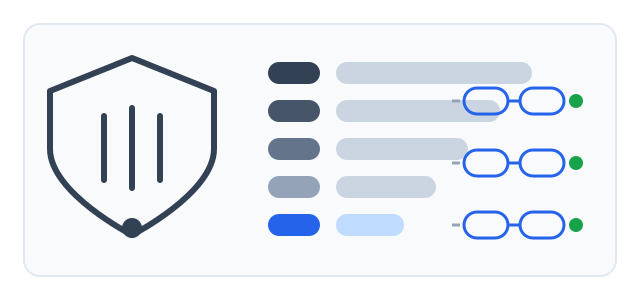

# AI Prison panel

The panel is the read-only view of the same durable ledger the eight tools use.
It answers four questions without writing anything:

1. **Which capabilities are revoked?** The L0–L5 matrix lists the 17 capability
   items and marks each one active, suspended or revoked.
2. **Is the ledger intact?** `verify` walks the hash chain; `records` and
   `segments` come from the same directory the CLI reads.
3. **What is the watchdog doing?** The memory waterline, freeze state, open
   incidents and crash plan come from the in-process watchdog snapshot.
4. **What is quarantined?** EnforceCard shows the plugin-level isolation list,
   the pause/freeze controls and the pending-boot boundary.

The panel never repairs, resets or writes the ledger. Destructive operations
remain explicit tool calls (`demo`, `drill`, `repair-tail`) and require
`confirm: true`.

## Data source

The default directory is `<session working directory>/.ai-prison`. A configured
`data_dir` takes precedence, and both the panel API and the agent tools enforce
the same allow-list. The ledger is append-only JSONL with per-record hash
chaining; a torn tail can be repaired, a hard-tampered record is refused.

## Safety boundary

GRAM, TLM, hardware binding and MicroVM isolation are simulated backends. The
panel and the CLI audit and demonstrate the governance flow; they do not create
a real container or revoke a real OS capability.
